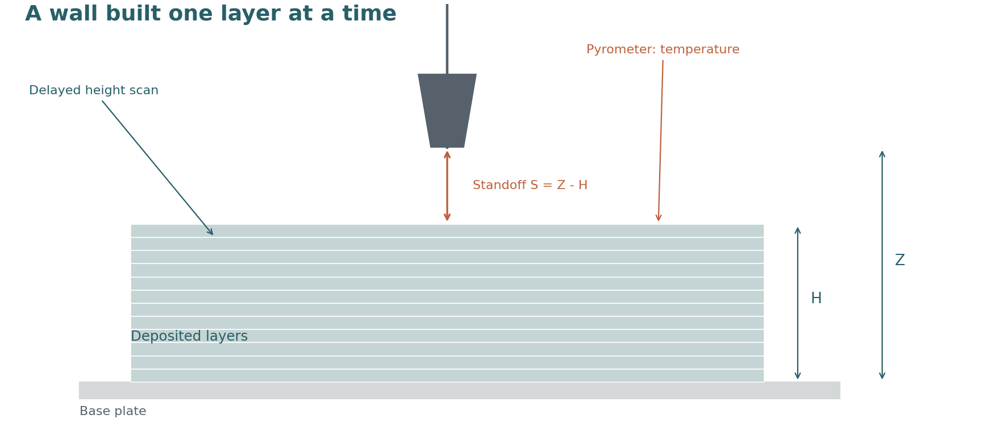
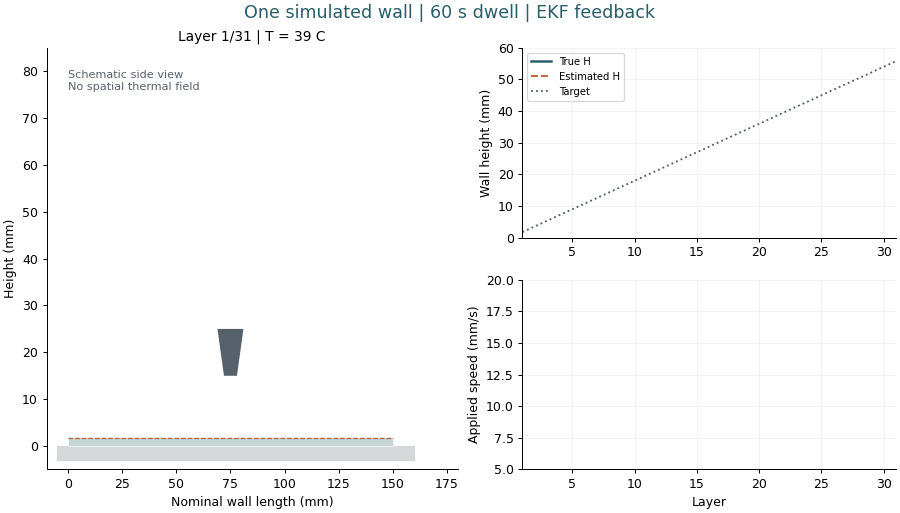
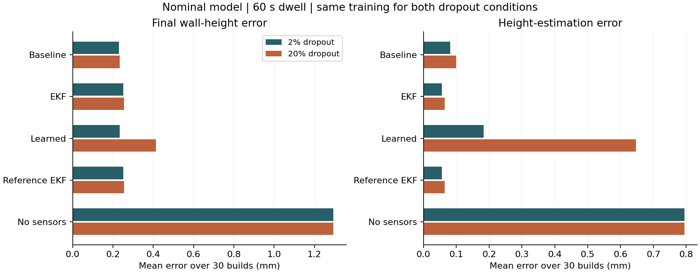

# WAAM sensor fusion

In wire-arc additive manufacturing, a welding torch feeds wire and builds a metal
wall one layer at a time. As the wall heats up, the same amount of material can
spread into a wider, lower bead. Small height errors then change the distance
between the nozzle and the wall.

I built this simulation to investigate a control question: **does a better
estimate of the process state lead to a better finished wall?**



The simulator supplies a known height, standoff and temperature. Three imperfect
sensor channels observe them: a delayed height scanner, a drifting pyrometer,
and a synthetic arc-based standoff signal. Different estimators use those
readings to drive the same travel-speed controller.

## A simulated build



Each step deposits a layer, cools the wall, takes measurements and estimates the
new state. The controller then chooses the next travel speed: an estimate above
the target makes it move faster and deposit a thinner bead. Nozzle lift follows
estimated growth to maintain clearance.

The drawing is a schematic side view generated from the simulation. The model
has one height and one temperature per layer; it does not calculate a spatial
thermal field, a melt pool or a robot trajectory.

## What the comparison shows

The current runs compare a latest-reading baseline, an extended Kalman filter
(EKF), a learned estimator with three gradient-boosted regressors, and a reference EKF with the nominal
nonlinear standoff curve. A fifth model receives the build schedule and applied
speed but no sensor readings. It checks how much can be predicted without sensing.



For 31 layers, 60 s dwell and controller gain 1, the mean final height errors
across 30 test builds are:

| Estimator | 2% scanner dropout | 20% scanner dropout |
|---|---:|---:|
| Latest-reading baseline | 0.230 mm | 0.235 mm |
| EKF | 0.251 mm | 0.256 mm |
| Learned | 0.233 mm | 0.414 mm |
| Reference EKF | 0.251 mm | 0.256 mm |
| Learned, no sensors | 1.294 mm | 1.294 mm |

At nominal dropout, the EKF estimates height more accurately than the baseline
(mean RMSE 0.056 versus 0.082 mm), but its final wall error is slightly larger.
Under increased dropout, the learned model's height estimates and final wall
error worsen. These point estimates describe this setting; small differences
are not presented as statistically significant wins.

The wider sweep changes estimator-model parameters, the CTWD measurement curve,
controller gain and generator assumptions. The [experiment report](reports/experiments/summary.md)
includes paired improvement checks. [Sensor selection](reports/sensor_selection/summary.md)
compares all eight sensor subsets separately for the EKF and learned model.

## What changed during development

The first version controlled nozzle height while scoring deposited wall height.
Those quantities were disconnected in its equations, so every estimator produced
the same final wall. That was a model-design problem, not evidence that estimation
does not matter. The current controller changes travel speed, which changes
bead area through mass conservation.

The revision also separates training and test builds, aligns sensor timing,
adds small physical differences between builds, and includes a no-sensor learned
baseline. The [revision record](docs/decisions/revision-2026-11-01.md) explains
which earlier claims were withdrawn. [Earlier files](reports/archive/README.md)
remain available for comparison.

## Run it

Tested with Python 3.11. The simulation does not need the PIONEER download.
From the project folder:

```bash
python -m pip install -r requirements.txt
python src/run_closed_loop.py
```

This prints estimator errors and writes build plots to `reports/experiments/`.
To reproduce the full analysis and README figures:

```bash
python src/run_experiments.py
python src/run_sensor_analysis.py
python src/make_figures.py
python -m unittest discover -s tests -v
```

The full runner fits the models once and uses them for both dropout conditions
and the generator variant. It writes the settings, package versions and source
hashes to [manifest.json](reports/experiments/manifest.json). Running it replaces
the current experiment outputs.

## Limits and further reading

This is a simulation study. The physical variation ranges, noise levels and
relative sensor costs are assumptions. The CTWD signal is a placeholder rather
than a model trained on welding waveforms. The reference EKF is a comparison
model, not an accuracy floor. The already inspected generator variant is a
sensitivity test, not an unseen validation set.

The optional [PIONEER data probe](data/README.md) inspects thermocouple logs and
final wall scans. It has not established measured per-layer height or a
calibration fit, so the simulator is not claimed to be calibrated or validated
against a real welding cell.

The [model notes](docs/design/process-and-sensor-model.md) give the equations and
measurement timeline. The [experiment protocol](docs/experiment-protocol.md)
defines splits, perturbations and scoring. [Study references](docs/learning-path.md)
cover filtering, validation and WAAM context.
